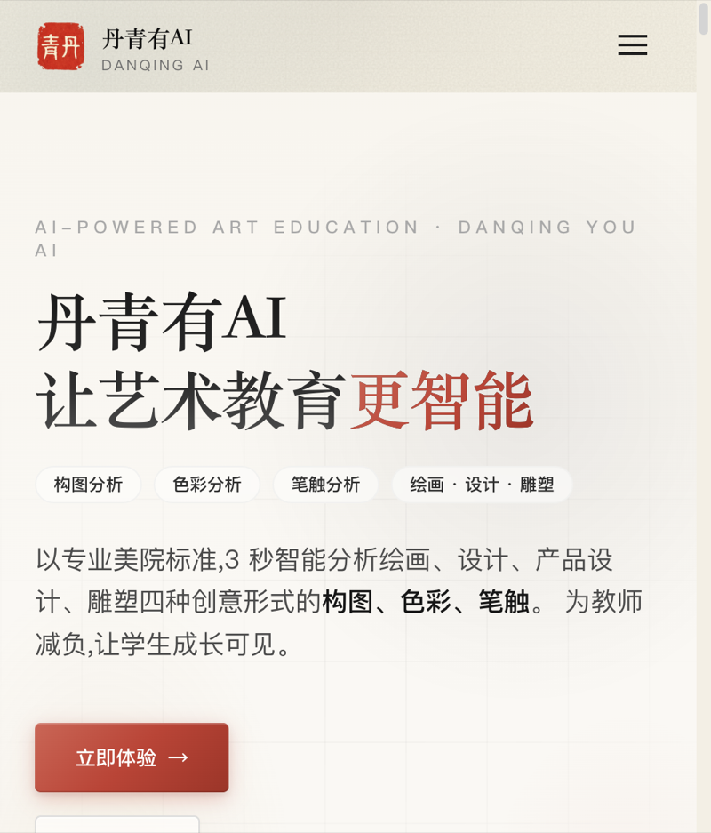
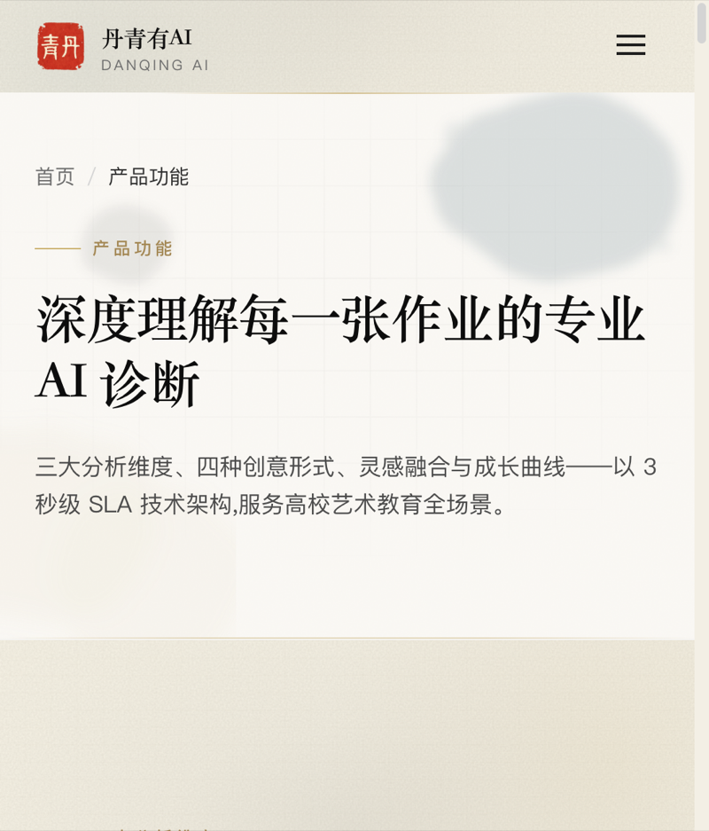
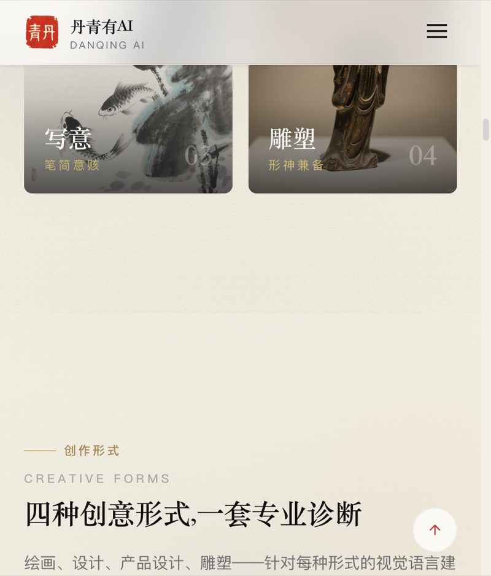
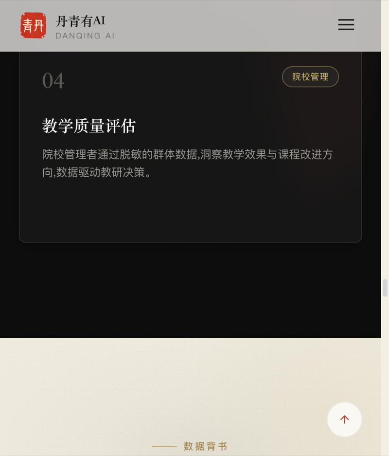
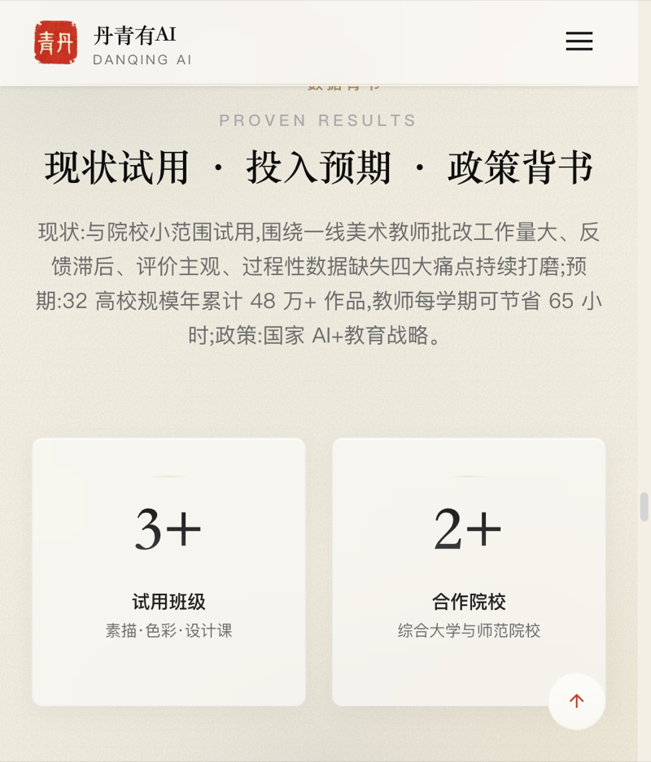

# 丹青有AI

> 专为高校艺术教育场景设计的 AI 助教系统。支持绘画、设计、产品设计、雕塑等多种创作形式，让每一份创作都得到专业的点评与指导。

## 项目简介

「丹青有AI」是一个面向高校艺术教育的全栈 AI 助教系统：学生上传作品后，系统在数秒内完成构图、色彩、原创性等维度的智能诊断，给出可操作的改进建议，并串联课堂素材生成、中式美学风格转换、成长追踪等完整教学闭环。

### 核心功能

| 功能 | 说明 |
|------|------|
| **智绘镜** | 智能感知作品复杂度，3 秒内完成构图、色彩、原创性三维度诊断 |
| **课堂素材生成器** | 输入课程主题，自动生成多组教学参考素材 |
| **中式美学风格库** | 内置水墨、青绿山水等非遗风格，一键转换草图风格 |
| **灵感嫁接** | 上传两张作品，AI 提取元素融合，8 种风格 × 6 种方法 × 4 级强度 |
| **情绪画布** | 输入情绪关键词，AI 生成对应色调的参考画面 |
| **成长追踪** | 记录每次诊断数据，生成能力变化曲线和最佳作品 |

## 产品预览

官方网站 [danqing.site](https://danqing.site) 实际运行界面：

| 官网首页 | 产品功能 · AI 诊断 | 创作形式 |
|------|------|------|
|  |  |  |

| 功能展示 | 数据背书 |
|------|------|
|  |  |

### 技术栈

- **前端**：React 18 + TypeScript + Vite 5 + Tailwind CSS 3 + React Router v6 + Recharts
- **官网**：Next.js（`website/`）
- **管理端**：React + Vite（`admin/`）
- **移动端**：React（`mobile/`）
- **后端**：Node.js + TypeScript + Prisma ORM + Redis（`server/`）
- **工程化**：Docker、Vercel、前后端测试门禁（Vitest）

## 在线演示

- **产品体验**：https://6a4f01878de2462eddd4b61e.vercel.app

## 开源范围说明（重要）

本仓库为**部分公开的工程快照**，用于展示项目的整体架构、工程化水平与产品形态：

**✅ 已公开的内容**

- 用户端前端完整源码（`src/`）
- 官网（`website/`）、管理端（`admin/`）、移动端（`mobile/`）
- 后端工程结构：路由、控制器、数据模型（Prisma Schema）、队列、缓存、测试（`server/`）
- Docker 与部署配置样例

**🔒 暂缓公开的内容（核心 AI 算法）**

以下模块涉及本项目的核心设计知识产权，具体实现**暂未随本仓库公开**，仅保留模块导出符号清单以展示接口边界（见 `server/src/services/` 下对应文件头注释）：

| 模块 | 职责 |
|------|------|
| `ai-vision.service.ts` | AI 视觉分析引擎：视觉提示词工程、标注框几何规整、置信度仲裁 |
| `analysis-engine.service.ts` | 分析调度引擎：多维度诊断编排与结果融合 |
| `ai-analysis.service.ts` | AI 分析服务层 |
| `generation.service.ts` | 教学素材 / 灵感嫁接 / 情绪画布生成引擎 |
| `style-analysis.service.ts` | 中式美学风格分析与转换 |
| `knowledge-card-generation.service.ts` | 知识卡片生成 |
| `knowledge-card-match.service.ts` | 知识卡片匹配 |
| `image-generation.service.ts` | 图像生成服务 |
| `grading-suggestion-engine.ts` | 评分建议引擎 |
| `marker-locator.ts` | 问题标注定位算法 |

> 完整实现的效果可通过上方在线演示直接体验；如有代码审阅需要，欢迎联系仓库所有者另行安排。
> 出于同样的保护目的，本仓库为全新初始化的单次提交，不包含原开发仓库的提交历史。

## 项目结构

```
├── src/                 # 用户端前端（React 18 + TS + Vite）
│   ├── components/      # 组件（含作品标注层、工作台等）
│   ├── pages/           # 页面
│   └── services/        # 前端服务层
├── server/              # 后端（Node.js + TS + Prisma + Redis）
│   ├── src/controllers/ # 控制器
│   ├── src/routes/      # 路由
│   ├── src/services/    # 业务服务（核心 AI 模块暂缓公开）
│   └── prisma/          # 数据模型与迁移
├── website/             # 官网（Next.js）
├── admin/               # 管理端
├── mobile/              # 移动端
├── public/              # 静态资源与素材库数据
└── .github/             # 仓库配置
```

## 本地开发

```bash
# 环境要求：Node.js >= 18，npm >= 9
npm install        # 安装前端依赖
npm run dev        # 启动前端开发服务器 (http://localhost:5173)

cd server && npm install   # 安装后端依赖
cp server/.env.example server/.env   # 参照示例补齐环境变量
```

> 注意：由于核心 AI 模块暂缓公开，本快照不保证可直接运行出完整功能，主要用于架构与工程化水平评审。

## 许可声明

本仓库内容仅供项目评审与学习交流参考，未附开源许可证，默认保留所有权利。未经许可请勿用于商业用途或二次分发。
